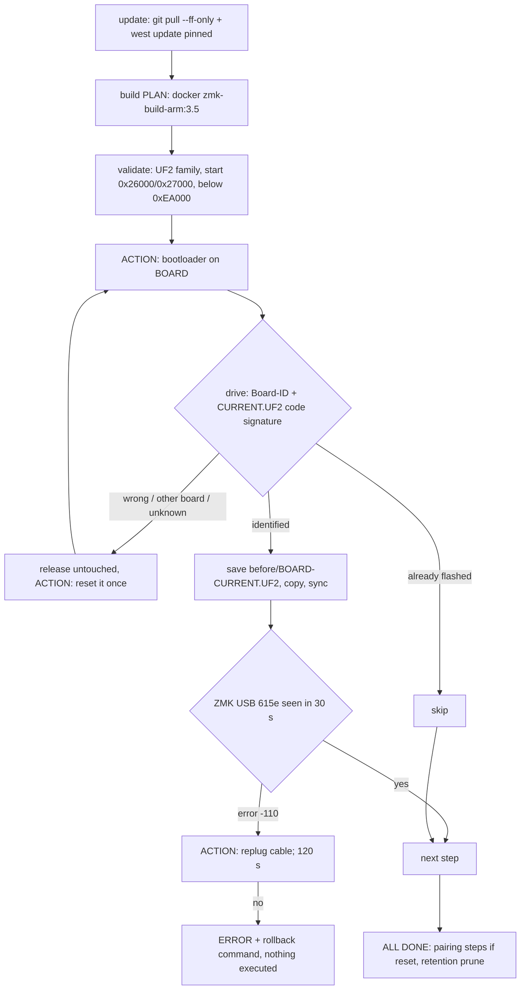

# Pones Corne flash skill

One script, `.agents/skills/zmk-flash/scripts/zmk-flash`, run from the repo root.
Flashing is **unattended**: do not ask the user to confirm steps. Start the
command as a background job, relay each `ACTION:` line to the user verbatim
(in their language), and keep watching until `ALL DONE` or `ERROR`.

## Flow



## Commands

| Command | Effect |
| --- | --- |
| `all PLAN [--reset]` | `update`, `build`, `flash` in one run. Default for "flash the keyboard". |
| `update` | Refuses on uncommitted tracked changes; `git pull --ff-only`; copies `config/west.yml` into the workspace; `west update`. Never bumps ZMK/module revisions: those change only via a reviewed `west.yml` commit. |
| `build [PLAN] [--reset]` | Builds into `$ZMK_WS/out/<commit12>[-dirty]/` with ELF, `.config`, `zephyr.dts`, logs, `build.json` (commit + west SHAs), `SHA256SUMS`. |
| `validate DIR\|FILE...` | Structural UF2 checks only; target inferred from the file name. |
| `flash PLAN [--reset] [--images DIR] [--accept-unknown]` | Guided flashing. Default images: `$ZMK_WS/out/<HEAD>`. |
| `mark-good [SESSION]` | After the user confirms everything works: marks the session (default latest complete) and pushes annotated tag `flash/<date>-<sha7>`. |
| `prune [--dry-run]` | Retention policy (runs automatically after every flash). |
| `status` | Sessions with `current`, `known-good`, `latest-good` flags. |

Plans: `dongle`, `left`, `right`, `halves` (left, right), `all` (dongle, left,
right), `full` (= `all --reset`). `--reset` flashes `settings_reset` before each
board's image; use it when the central/peripheral roles or BT bonds change.

Bootloader entry: dongle SYS+Z, left SYS+Q, right SYS+P (SYS = hold the right
outer thumb), or double-tap the board's reset. After `settings_reset` the
SYS keys are gone; the user must double-tap reset.

Workspace: `ZMK_WS` (default `../zmk-config-build/ws`), a west
workspace whose manifest is `config/west.yml`; the repo is mounted read-only at
`/config-src` inside the container.

## Board identification

Both halves share Board-ID `nRF52840-nicenano`, so `flash` compares the first
32 KiB of code in the drive's `CURRENT.UF2` with every image recorded in
`backups/*/before` and `backups/*/flashed`:

- matches the step's board, or the image about to be written (skip) → proceed;
- matches another board → release, ask for the right board;
- unknown → release unless `--accept-unknown` (still backed up first);
- right after its `settings_reset` step the board runs the shared reset image,
  so identity follows plan order.

## Backups and retention

`backups/` is gitignored. One directory per flash session,
`backups/<YYYY-MM-DDTHHMMSS>-<plan>[-reset]/`:

- `before/<board>-CURRENT.UF2` + `INFO_UF2.TXT`: the board's flash read right
  before writing (includes SoftDevice; for diagnosis and as identity reference);
- `flashed/`: written UF2s, per-image ELF/.config/dts, `SHA256SUMS`;
- `manifest.json`: source commit + west SHAs, image hashes, per-step device,
  before-hash, identification and status, `boards` (what each board runs after
  the session), `known_good`, `tag`.

Retention after each flash keeps: the 5 newest sessions, the latest
known-good session, and every session whose `boards` entry is what a board
runs now. Everything else is deleted. `flash/*` tags are never deleted; they
rebuild any known-good firmware from source.

## Rollback

Never automatic. On `ERROR` the script prints the command; run it only after
the user asks:

```sh
.agents/skills/zmk-flash/scripts/zmk-flash flash <plan> --images backups/<known-good-session>/flashed
```

## Failure handling

- `WRONG BOARD` / `UNEXPECTED`: nothing was written; relay the `ACTION:` line,
  the script keeps waiting.
- `error -110` after reboot (seen behind the KVM): the host gave up
  enumerating; the script asks for a cable replug and waits 120 s.
- `done-no-usb-seen`: the drive detached but the kernel logged no ZMK USB
  device (PID 615e) within 30 s; check the board boots (dongle screen,
  battery widgets) before continuing.
- Drive never detaches: `ERROR`, flash state unknown; the user re-enters the
  bootloader and you rerun the same plan (non-reset steps whose board already
  runs the target image are skipped).
