# Pones Corne

[](https://zmk.dev/)
[](docs/hardware.md)
[](LICENSE)

**Thirty-six keys, a thumb-sized trackpad, and a dongle that keeps your status in sight.**



Pones Corne is a personal ZMK configuration for a five-column Corne with a
right-hand Cirque trackpad and a Prospector dongle running a YADS screen.
Keep typing, pointing, navigation, and host controls within reach without
adding another row of keys. Build locally, connect through the dongle, and
keep a recoverable copy of each device's firmware when you flash.

---

## What it is

A wireless split keyboard with a dedicated central: both halves send keys to
one Prospector dongle, which sends keyboard and mouse reports to your host
through USB or Bluetooth. The halves need the dongle; their USB connections
are for flashing and power, not independent host input.

- **36 keys:** a true 3×5 + 3-thumb layout on each half, with no padded column.
- **Three controllers:** two nice!nano v2 boards and a XIAO BLE in the dongle.
- **Pinned firmware:** ZMK v0.3.0 (pinned in `config/west.yml`).
- **US ANSI host layout:** symbols and shortcuts use HID keycodes.

Requires nRF52840 controllers. Check the PCB pinout, controller orientation,
and regulated 3.3 V trackpad supply before flashing or connecting hardware.
Do not connect a powered TRRS cable between wireless halves.

---

## Highlights

- **Status at a glance.** The YADS dongle screen shows output, Bluetooth
  profile, active layer, modifiers, typing speed, and each half's battery.
  Ambient-light sensing adjusts brightness; the screen blanks after idle.
- **Point without leaving the keys.** Use the right-hand Cirque Pinnacle pad
  for cursor movement. Hold Backspace to scroll on both axes; release to point.
  Toggle precision ×1 or fast ×6 movement from SYS.
- **Home-row modifiers.** Tap letters, hold for modifiers. Six thumb keys
  double as layer controls, with a tap-preferred 220 ms hold threshold.
- **Layers for real work.** Numbers, symbols, navigation, media, application
  macros, and KVM hotkeys sit behind dedicated thumb holds.
- **Recoverable flashing.** The local flash tool identifies each device,
  backs up its current image, and tags each known-good flash after testing.

Hardware communication, pairing, power behavior, and KVM acceptance still
need validation on the actual keyboard. See [recorded results and known
limitations](docs/validation.md) before treating a successful build as proof
of hardware readiness.

---

## Layout

Base layer, viewed from above:

```text
Q  W  E  R  T       Y  U  I  O  P
A  S  D  F  G       H  J  K  L  ;
Z  X  C  V  B       N  M  ,  .  '
    Esc Tab Space   Enter Bspc Del
```

| Hold | Layer | What you get |
| --- | --- | --- |
| Space | NUMBER | F1–F12, a right-hand number pad, arithmetic |
| Tab | SYMBOL | Delimiters, punctuation, copy/paste shortcuts |
| Enter | MOVE | Herdr commands, tab switching, media, KVM hotkeys |
| Escape | NAV | Arrows, Home/End, paging, browser back/forward |
| Backspace | MOUSE | Two-axis pad scrolling, fallback movement and clicks |
| Delete | SYS | Device reset/bootloader, host profiles, output, pad speed |

Hold a thumb **past 220 ms** before pressing a layer key. Tap it for its
ordinary key. Press **F+J within 30 ms** on base to toggle Caps Word.
The two transparent PAD speed layers change pointing speed, not key bindings.

See the [full layout reference](docs/layout.md) for home-row modifiers,
symbol tap dances, macro sequences, and per-device system controls.

---

## Quick start

1. **Build all three images.** Follow the [local toolchain setup and west
   commands](docs/build-and-flash.md#build-locally-with-west). Use
   `pones_corne_left` and `pones_corne_right` on `nice_nano_v2`, then
   `pones_corne_dongle dongle_screen` on `seeeduino_xiao_ble`. The dongle
   build also needs the vendored YADS module.
2. **Flash with backups.** Follow the [flash workflow](docs/build-and-flash.md#flash-reset-bonds-and-pair).
   Use a full settings reset when changing central/peripheral roles or bonds;
   this erases settings and bonds. Keep the halves off until their pairing turn.
3. **Pair left, then right.** Plug in the dongle, power only the left half,
   and wait for its battery to appear on the screen. Then power the right half.
   For a Bluetooth host, **hold Delete >220 ms → SYS; A/S select profile
   0/1; G selects BLE**. Pair **Pones Corne** in your host's Bluetooth UI.
   **SYS+F selects USB** for a host or KVM. Forget a stale host bond first.
4. **Test before marking good.** Check all 36 keys, tap/hold behavior, pad
   movement and scrolling, displays, and application/KVM macros. Then use
   `mark-good` in the flash tool.

There is no GitHub Actions firmware build workflow: firmware is built locally.
The [build and flash reference](docs/build-and-flash.md) includes dependencies,
commands, artifact locations, troubleshooting, and the complete pairing sequence.

---

## How it works

```text
Left half: keys + OLED ────── BLE ───┐
                                   ├─ Prospector + YADS ── USB/BLE ── Host
Right half: keys + Cirque ─── BLE ───┘
```

The right half forwards physical trackpad events to the dongle. The dongle
applies cursor scaling or the held-MOUSE scrolling override, then emits host
mouse reports. Tuning those processors needs only a dongle rebuild; sensor
orientation and sensitivity changes need a right-half rebuild.

The screen runs on the dongle, while the left OLED uses ZMK's stock
peripheral status display. The right OLED is disabled.

---

## Documentation

| Topic | Doc |
| --- | --- |
| Controllers, screens, central roles, matrix wiring | [Hardware](docs/hardware.md) |
| All layers, home-row mods, symbols, macros, system keys | [Layout and behavior](docs/layout.md) |
| Cirque model checks, wiring, input processors, tuning | [Trackpad](docs/trackpad.md) |
| Toolchain, builds, backups, flashing, pairing | [Build and flash](docs/build-and-flash.md) |
| Recorded build/runtime results and known limitations | [Validation](docs/validation.md) |

The keymap image is generated from [`config/pones_corne.keymap`](config/pones_corne.keymap).
See [image regeneration](docs/layout.md#regenerate-the-keymap-image) when changing bindings.

---

## License

[MIT](LICENSE). The vendored YADS module keeps its own MIT license, and files
with separate SPDX headers retain their stated licenses, including the
Apache-2.0 ST7789 driver. See [vendored licensing](docs/validation.md#licensing).
